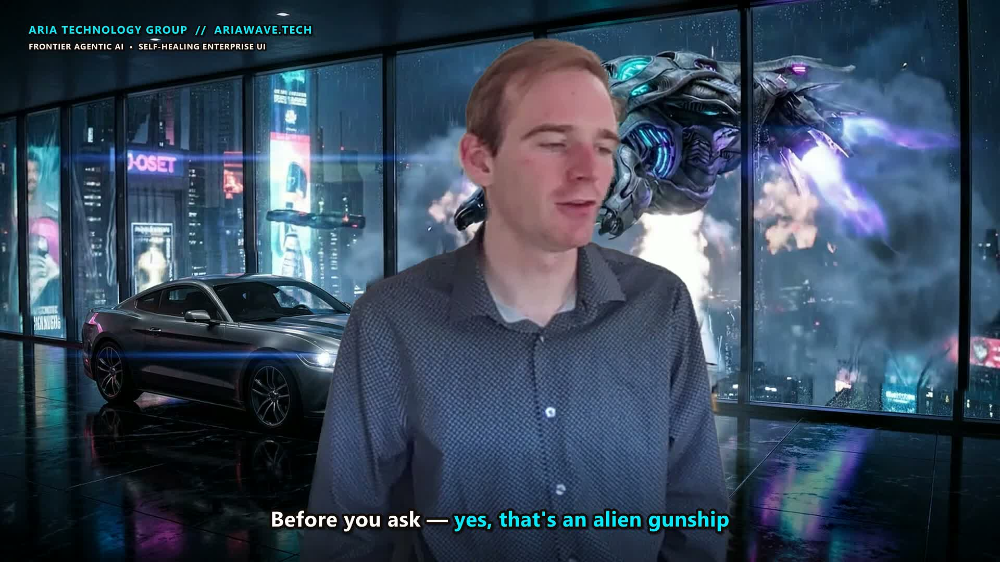

# Ariawave LinkedIn Studio // Autonomous Executive Video & Token-Arbitrage Pipeline

**Built by [Aria Technology Group](https://www.ariawave.tech)**  
*Frontier Agentic AI • Subscription Token Arbitrage • Self-Healing Enterprise UI • Open-Source Sovereign Media Tooling*

📅 **[Book a 1-on-1 Enterprise AI & Token Management Consultation with Andrew Jennings](https://scheduler.zoom.us/andrew-jennings-rzou8s/technology-consult)**  
🌐 **[Enterprise AI Strategy & Architecture Portal (`ariawave.tech/#contact`)](https://www.ariawave.tech/#contact)**



---

## 💰 Token Management Strategies: Why Enterprises Need Aria Technology Group to Manage Their AI Stack

Most companies bleed thousands of dollars a month in **double-taxed AI spend**: they pay **per-second/per-token API overages** (`$3.17+` per video on pay-as-you-go endpoints) while **80% to 90% of their pre-paid monthly SaaS subscription tokens expire unused** at the end of every billing cycle.

In this repository (`run_zero_cost_browser_studio.py`), **Aria Technology Group** demonstrates **Autonomous Subscription Token Arbitrage**:
1. **Live Quota Telemetry &Unused Pool Discovery:**
   - Queries subscription endpoints (`https://api.elevenlabs.io/v1/user/subscription`) in real time to audit unused monthly credit pools (e.g., **213,396 unused ElevenLabs Creator credits — 85.3% of the monthly plan sitting idle**).
2. **Unified Web-Studio Arbitrage via Kimi WebBridge (`127.0.0.1:10086`):**
   - Instead of routing character swaps and lip-sync renders to paid external APIs (`$3.17/video`), our autonomous browser agent attaches to the logged-in **ElevenLabs Image & Video Web Studio** (`https://elevenlabs.io/app/image-video`) where the **exact same frontier models** are included inside the existing monthly subscription pool:
     - **Character Reference Swap:** `FLUX.1 Kontext [Pro]` (`242` credits) / `FLUX.2 [Pro]` (`182` credits)
     - **Expressive 1080p/2K Lip-Sync Video:** `HeyGen Avatar 4` (`1,212` credits/s), `MiniMax H3 Max Lip Sync` (`485` credits/s), `Sync Lipsync 2 Pro` (`661` credits/s), `Creatify Aurora` (`848` credits/s), and `OmniHuman 1.5` (`1,267` credits/s).
3. **Sub-Second Decision-Making Model (`google/gemini-2.5-flash` @ `~450ms–600ms`):**
   - Pairs deterministic `DataTransfer` DOM file injection (`0ms` overhead) with a `~600ms` JSON Decision-Making Model that inspects compact DOM snapshots and navigates dynamic Radix UI dialogs automatically.

### Live Production Cost Comparison (`57.8s` Executive Broadcast Master)

| Pipeline Stage | Standard Naive Cloud API Stack | Aria Token-Arbitrage Stack (`run_zero_cost_browser_studio.py`) | Net Out-of-Pocket Savings |
| :--- | :--- | :--- | :--- |
| **Dual-Mic `(L - R)` Pre-Echo DSP + O(1) Guided Matting** | `$0.00` (Local GPU) | **`$0.00`** (Local RTX GPU) | `100%` |
| **Syllable-Locked Voice Swap (`eleven_multilingual_sts_v2`)** | `$0.07` | **`$0.00` extra** (`~450` unused Creator credits) | `100%` |
| **Character Pose Edit (`FLUX.1 Kontext [Pro]`)** | `$0.04` (FAL API) | **`$0.00` extra** (`242` unused Creator credits) | `100%` |
| **1080p Expressive Lip-Sync (`HeyGen Avatar 4` / `Kling v2`)** | `$3.13` (FAL API) | **`$0.00` extra** (`8,484` unused Creator credits via WebBridge) | **`100% ($3.24 -> $0.00)`** |

> **Why You Need Aria Technology Group to Manage This For You:**  
> Open-source scripts give you the building blocks, but **enterprise token management, multi-provider quota routing, browser session orchestration, and self-healing UI guardrails** require continuous architectural engineering. **Aria Technology Group** builds and manages autonomous token-routing engines that harvest your organization's stranded SaaS quotas across ElevenLabs, Google Workspace/Vertex, OpenAI, Anthropic, and local RTX/ Blackwell GPU clusters—turning wasted monthly subscriptions into **$0.00 marginal-cost production outcomes**.

---

## Core Pipeline Capabilities

1. **Live OBS Studio WebSocket v5 Framing & Teleprompter HUD (`teleprompter/obs_teleprompter_hud.py`)**
   - Connects directly to OBS Studio (`ws://127.0.0.1:4455`), unlocks and centers the Insta360 X5 studio camera, and docks an always-on-top eye-line teleprompter HUD at `Y=0` directly below the camera lens.
2. **Dual-Mic Pre-Echo Cancellation (`scripts/build_linkedin_v3_clean.py`)**
   - Solves the `195.4ms` pre-echo caused when OBS records both an **Insta360 X5** (`195.4ms` internal stitching delay) and a zero-latency mono **USB Backup Mic** onto Track 1 via `(L - R) * 0.80` stereo difference.
3. **Natural O(1) Guided Filter Matting (`build_steve_jobs_max_hook_master.py`)**
   - Pairs MediaPipe Selfie Segmentation with an O(1) **Guided Filter** (`r=8, eps=5e-4`) so the speaker and AI-swapped persona are composited over the **continuously moving** Alien Gunship + Mustang S550 background without freezing the scene.
4. **Zero-Cost Browser Studio & Decision Engine (`run_zero_cost_browser_studio.py`)**
   - Automates ElevenLabs Image & Video Studio via the Kimi WebBridge (`127.0.0.1:10086`) and `google/gemini-2.5-flash` decision routing to generate `$0.00` **HeyGen Avatar 4** / **MiniMax H3 Max** lip-sync takes from unused monthly subscription credits.
5. **Live Omnichannel Engagement & Ranking Tracker (`track_steve_jobs_campaign_rank.py`)**
   - Scrapes live LinkedIn impressions/reactions, YouTube Shorts telemetry, and DEV.to metrics into an executive desktop dashboard (`STEVE_JOBS_OMNICHANNEL_ENGAGEMENT_RANKER.html`).

---

## Repository Structure

```text
ariawave-linkedin-studio/
├── assets/
│   └── preview_frame_v3.jpg                   # Verified composite frame (natural matting + captions)
├── scripts/
│   ├── build_linkedin_v3_clean.py             # Dual-mic (L - R) cancellation, O(1) Guided Filter matting & 2K upscale
│   └── kimi_webbridge_daemon.py               # Local WebBridge daemon (ws://127.0.0.1:10086/ws + POST /command)
├── run_zero_cost_browser_studio.py            # $0.00 Token-Arbitrage Browser Engine (Kimi WebBridge + Gemini 2.5 Flash)
├── build_steve_jobs_max_hook_master.py        # 1.1s Instant Hook + 22.5s Midway Steve Jobs Holographic Composite Builder
├── track_steve_jobs_campaign_rank.py          # Live Omnichannel Engagement & Leaderboard Tracker
├── steve_jobs_campaign_telemetry.json         # Latest synced cross-channel campaign telemetry
├── skills/
│   └── ariawave-linkedin-studio/
│       └── SKILL.md                           # Agent skill definition for Ariawave rigs
└── teleprompter/
    ├── Aria_LinkedIn_Teleprompter.html        # Standalone browser teleprompter + script copy
    └── obs_teleprompter_hud.py                # Always-on-top Tkinter eye-line teleprompter synced with OBS WebSocket
```

---

## Book an Enterprise AI & Token Management Audit

Stop paying twice for AI compute. Partner with **Aria Technology Group** to unify your subscription token pools, deploy self-healing generative UI, and automate your media & operational workflows:
- 📅 **1-on-1 Zoom Consultation with Andrew Jennings:** [https://scheduler.zoom.us/andrew-jennings-rzou8s/technology-consult](https://scheduler.zoom.us/andrew-jennings-rzou8s/technology-consult)
- 🌐 **Aria Technology Group:** [https://www.ariawave.tech/#contact](https://www.ariawave.tech/#contact)
